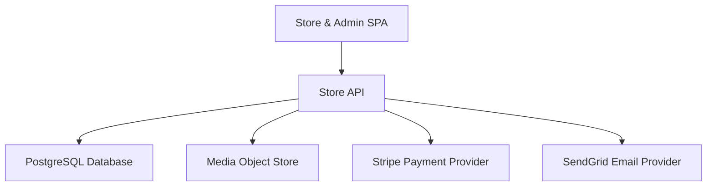
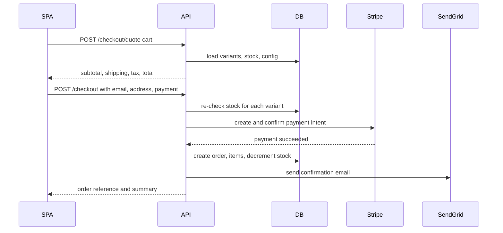
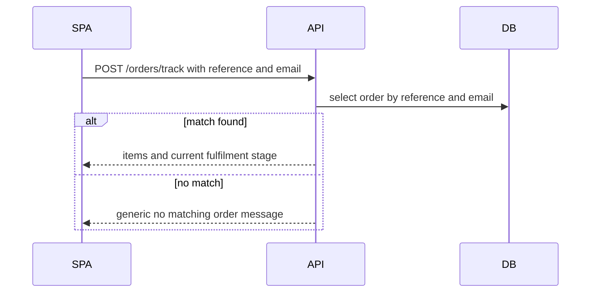
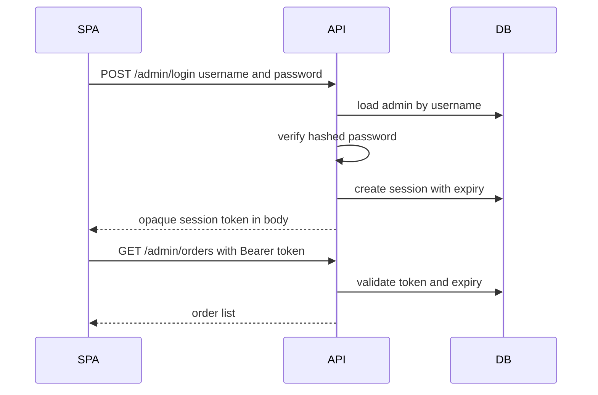
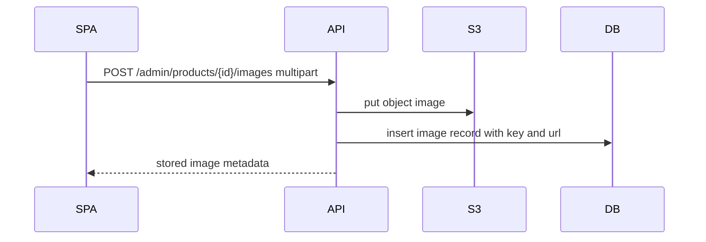
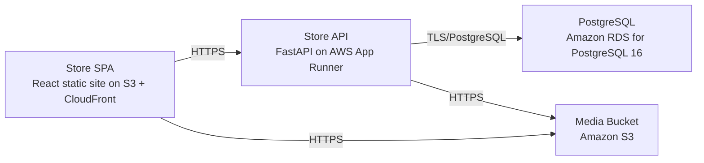

# Architecture

> Maintained by QuorQ AI SDLC. Text between `sdlc:auto` markers is regenerated; anything outside them is yours and is kept.

<!-- sdlc:auto:start narrative -->
## Overview

### ARCH-OVERVIEW · approved · source: architecture:summary

Approved v1 architecture for a lightweight, mobile-responsive clothing store: React 19 SPA, FastAPI 0.115 backend, PostgreSQL 16, all on AWS.

Customers browse a category catalogue, view product detail with size/colour variants and per-variant stock, build a client-side cart, and check out as guests paying by card through Stripe. Each paid order gets a unique reference and a SendGrid confirmation email, and can be tracked without login by reference plus email. Admins sign in to a protected area (opaque server-side session token) to manage products, variants, images (S3 media bucket), orders/fulfilment stages, and store-wide country/currency, flat-rate shipping with free-shipping threshold, and a single tax rate.

**Related:** COMP-SPA, COMP-API, COMP-DB, COMP-MEDIA, COMP-PAYMENT, COMP-EMAIL

### COMP-SPA · approved · source: architecture:components.spa

Mobile-responsive React 19 single-page app serving both the customer storefront and the protected admin area.

Serves catalogue, product detail, cart, checkout and order-tracking screens for customers plus the admin management UI. Holds the shopping cart entirely client-side (no server cart entity) and stores the admin session token after login.

**Related:** COMP-API

### COMP-API · approved · source: architecture:components.api

FastAPI 0.115 backend exposing catalogue, pricing, checkout/payment, order tracking, and admin auth/management endpoints.

Enforces business rules server-side: stock availability, shipping/tax calculation rules, and order-lookup guarding (reference+email match required). Orchestrates calls to Stripe for payment and SendGrid for confirmation email, and persists all state to PostgreSQL.

**Related:** COMP-DB, COMP-MEDIA, COMP-PAYMENT, COMP-EMAIL, COMP-SPA, CP-CHECKOUT, CP-TRACKING, CP-ADMIN-AUTH, CP-IMAGE-UPLOAD

### COMP-DB · approved · source: architecture:components.db

PostgreSQL 16 database holding all persistent store state.

Stores products, variants, product images metadata, orders, order items, admin users, admin sessions and the single-row store configuration (country, currency, tax rate, shipping rules).

**Related:** COMP-API, DATA-MODEL

### COMP-MEDIA · approved · source: architecture:components.media_store

AWS S3 bucket holding uploaded product images as the app's own media storage.

Receives images uploaded by admins via the API, and serves the resulting image URLs to the storefront SPA for product display.

**Related:** COMP-API, COMP-SPA

### COMP-PAYMENT · approved · source: architecture:components.payment

Stripe is the external payment provider used at checkout.

Takes card payment for the cart's grand total during checkout. The store does not store card details itself; the resulting Stripe payment intent id is recorded on the order.

**Related:** COMP-API, CP-CHECKOUT

### COMP-EMAIL · approved · source: architecture:components.email

SendGrid is the external transactional email provider.

Sends the order confirmation email after a successful checkout, containing the order reference, ordered items and total.

**Related:** COMP-API, CP-CHECKOUT

### CP-CHECKOUT · approved · source: architecture:critical_paths.guest_checkout_and_payment

End-to-end guest checkout: price, confirm stock, pay, then create the order.

Customer submits email, in-country shipping address and card. The API prices the cart (subtotal, flat-rate shipping or free over threshold, single tax rate), confirms stock, takes payment via Stripe, and only then creates the order with a unique reference, decrements stock and triggers the confirmation email. A failed payment or a sold-out variant blocks order creation and preserves the cart.

**Related:** COMP-API, COMP-PAYMENT, COMP-EMAIL, COMP-DB, COMP-SPA, API-CHECKOUT

### CP-TRACKING · approved · source: architecture:critical_paths.order_tracking_by_reference_and_email

Guests track an order without login using reference plus email.

Customer submits order reference and email; the API returns order items and current fulfilment stage only when both match. A single generic not-found message is returned otherwise, so neither value is revealed as the mismatched one.

**Related:** COMP-API, COMP-DB, API-TRACKING

### CP-ADMIN-AUTH · approved · source: architecture:critical_paths.admin_sign_in_and_session_protection

Admin authentication via hashed credentials and an opaque server-side session token.

Admin signs in with username and password verified against a hashed credential; the API issues an opaque session token returned in the response body, which the SPA stores and sends as a Bearer token. Protected endpoints validate the token and its expiry; sign-out revokes the token server-side.

**Related:** COMP-API, COMP-DB, COMP-SPA, API-ADMIN-AUTH

### CP-IMAGE-UPLOAD · approved · source: architecture:critical_paths.product_image_upload

Signed-in admins upload and remove product images, stored in S3.

Signed-in admin uploads one or more images; the API validates and stores each object in the S3 media bucket and records its metadata against the product. Removing an image deletes both the S3 object and its database record.

**Related:** COMP-API, COMP-MEDIA, COMP-SPA, API-ADMIN-PRODUCTS

### DATA-MODEL · approved · source: architecture:entities

Relational data model covering catalogue, orders, admin access and store configuration.

category(id, name, slug); product(id, category_id, name, description, price, created_at, updated_at); product_variant(id, product_id, size, colour, stock_quantity); product_image(id, product_id, s3_key, url, position); customer_order(id, order_reference, email, shipping_name, shipping_line1, shipping_line2, shipping_city, shipping_postcode, shipping_country, subtotal, shipping_amount, tax_amount, grand_total, currency, fulfilment_stage, stripe_payment_intent_id, created_at); order_item(id, order_id, variant_id, product_name, size, colour, unit_price, quantity, line_total); admin_user(id, username, password_hash, created_at); admin_session(token, admin_user_id, expires_at, created_at); store_config(id, country, currency, tax_rate, flat_shipping_amount, free_shipping_threshold, pending_confirmation).

**Related:** COMP-DB

### API-CATALOG · approved · source: architecture:endpoints

Public storefront catalogue endpoints.

GET /categories - list categories. GET /categories/{slug}/products - list available products in a category with thumbnail, name and price; empty category returns an empty array. GET /products/{id} - product detail with images, description, price and variants including per-variant stock availability.

**Related:** COMP-API, DATA-MODEL

### API-CHECKOUT · approved · source: architecture:endpoints

Cart pricing and checkout endpoints.

POST /checkout/quote - price a cart: subtotal, flat-rate or free shipping, tax and grand total in store currency. POST /checkout - validate stock and in-country address, take card payment via Stripe, create the order and send the confirmation email.

**Related:** COMP-API, CP-CHECKOUT

### API-TRACKING · approved · source: architecture:endpoints

Guest order-tracking endpoint.

POST /orders/track - returns order items and current fulfilment stage only when reference and email both match; generic not-found response otherwise.

**Related:** COMP-API, CP-TRACKING

### API-ADMIN-AUTH · approved · source: architecture:endpoints

Admin authentication endpoints.

POST /admin/login - admin sign-in; returns an opaque session token in the body on success, generic error otherwise. POST /admin/logout - revokes the current admin session token server-side.

**Related:** COMP-API, CP-ADMIN-AUTH

### API-ADMIN-PRODUCTS · approved · source: architecture:endpoints

Admin endpoints for managing products, variants and images.

GET /admin/products - list products for admin management. POST /admin/products - create a product with name, category, description and price; validation errors returned for missing name or invalid price. PUT /admin/products/{id} - edit a product's name, category, description or price. POST /admin/products/{id}/variants - add or update size/colour variants and per-variant stock. POST /admin/products/{id}/images - upload one or more product images to S3 media storage. DELETE /admin/products/{id}/images/{image_id} - delete a product image from storage and the product.

**Related:** COMP-API, COMP-MEDIA, CP-IMAGE-UPLOAD, DATA-MODEL

### API-ADMIN-ORDERS · approved · source: architecture:endpoints

Admin endpoints for viewing and fulfilling orders.

GET /admin/orders - list placed orders with reference, email, total, date and current stage. GET /admin/orders/{id} - order detail with items, variants, quantities, totals, shipping address and stage. PATCH /admin/orders/{id}/stage - advance an order to a later fulfilment stage, recorded manually within the app.

**Related:** COMP-API, CP-CHECKOUT, DATA-MODEL

### API-ADMIN-CONFIG · approved · source: architecture:endpoints

Admin endpoints for store-wide configuration.

GET /admin/config - read store configuration (country, currency, tax rate, shipping flat rate and threshold). PUT /admin/config - update country, currency, tax rate, flat shipping amount and free-shipping threshold.

**Related:** COMP-API, DATA-MODEL

### DEPLOY-SPA · approved · source: architecture:deployment_nodes.store_spa

Store SPA is deployed as a static React build.

React static site hosted on S3 + CloudFront, serving the static assets produced by the React 19 build.

**Related:** COMP-SPA

### DEPLOY-API · approved · source: architecture:deployment_nodes.store_api

Store API runs as a containerized FastAPI service.

Deployed on AWS App Runner as a Python 3.12 container running FastAPI 0.115 under Uvicorn.

**Related:** COMP-API

### DEPLOY-DB · approved · source: architecture:deployment_nodes.postgresql

Managed PostgreSQL 16 database.

Hosted on Amazon RDS for PostgreSQL 16.

**Related:** COMP-DB

### DEPLOY-MEDIA · approved · source: architecture:deployment_nodes.media_bucket

Product media object storage.

Hosted on Amazon S3 as general object storage for uploaded product images.

**Related:** COMP-MEDIA

### TECH-FRONTEND · approved · source: architecture:technology_decisions.frontend

React 19 approved as the frontend stack, over Vue and SvelteKit alternatives.

Built as a mobile-responsive SPA (Vite build) covering both storefront and admin, reading the API base URL from VITE_API_BASE_URL and sending the admin session token as a Bearer header.

**Related:** COMP-SPA

### TECH-BACKEND · approved · source: architecture:technology_decisions.backend

FastAPI 0.115 approved as the backend stack, over Django REST Framework and Flask alternatives.

Hosts catalogue, pricing, checkout/payment orchestration, order tracking and admin management, with Pydantic validation for checkout and product forms.

**Related:** COMP-API

### TECH-DATABASE · approved · source: architecture:technology_decisions.database

PostgreSQL 16 approved as the database, over MySQL and SQLite alternatives.

Stores catalogue, orders, admin users, sessions and the single-row store config; uses numeric money columns and transactional stock decrement at checkout.

**Related:** COMP-DB

### TECH-CLOUD · approved · source: architecture:technology_decisions.cloud

AWS approved as the cloud platform, over GCP and Azure alternatives.

SPA on S3+CloudFront, API on App Runner, RDS for PostgreSQL 16, and product media in a dedicated S3 bucket as the app's own media storage.

**Related:** COMP-SPA, COMP-API, COMP-DB, COMP-MEDIA
<!-- sdlc:auto:end narrative -->

<!-- sdlc:auto:start building-blocks -->
## Building Block View

| ID | Name | Technology | Responsibility | Depends on |
|---|---|---|---|---|
| spa | Store & Admin SPA | React 19 | Mobile-responsive React app serving the customer storefront (catalogue, product, cart, checkout, order tracking) and the protected admin area. Holds the cart client-side and stores the admin session token. | api |
| api | Store API | FastAPI 0.115 | FastAPI backend exposing catalogue, cart pricing, checkout/payment, order creation, order tracking, admin auth and admin management endpoints. Enforces stock, shipping/tax rules and order-lookup guarding. | db, media_store, payment, email |
| db | PostgreSQL Database | PostgreSQL 16 | Stores products, variants, images metadata, orders, order items, admin users, admin sessions and store configuration. | — |
| media_store | Media Object Store | AWS S3 | Holds uploaded product images in the app's own media storage on AWS; serves image URLs to the storefront. | — |
| payment | Stripe Payment Provider | Stripe | Takes card payment for the grand total at checkout; no card details are stored by the store. | — |
| email | SendGrid Email Provider | SendGrid | Sends transactional order confirmation emails containing the order reference, items and total. | — |

<!-- sdlc:auto:end building-blocks -->

<!-- sdlc:auto:start runtime -->
## Runtime View

### Guest checkout and payment

Customer submits email, in-country shipping address and card. The API prices the cart (subtotal, flat-rate shipping or free over threshold, single tax rate), confirms stock, takes payment via Stripe, and only then creates the order with a unique reference, decrements stock and triggers the confirmation email. Failed payment or a sold-out variant blocks order creation and preserves the cart.

- **Components:** spa, api, db, payment, email
- **Modules:** checkout_router, pricing_service, stock_service, payment_service, order_service, email_service
- **Key functions:** quote_cart(items, config), reserve_and_validate_stock(items), create_payment_intent(amount, currency), confirm_payment(intent_id), place_order(email, address, items, totals), generate_order_reference(), send_confirmation_email(order)

### Order tracking by reference and email

Customer submits order reference and email; the API returns order items and current fulfilment stage only when both match, with a single generic not-found message otherwise so neither value is revealed as the mismatch.

- **Components:** spa, api, db
- **Modules:** tracking_router, order_service
- **Key functions:** lookup_order(reference, email), to_tracking_view(order)

### Admin sign-in and session protection

Admin signs in with username and password verified against a hashed credential; the API issues an opaque session token returned in the body, stored by the SPA and sent as a Bearer token. Protected endpoints validate the token and its expiry; sign-out revokes it server-side.

- **Components:** spa, api, db
- **Modules:** auth_router, session_service, password_service, auth_dependency
- **Key functions:** verify_password(input, hash), create_session(admin_id), require_admin(token), revoke_session(token)

### Product image upload

Signed-in admin uploads one or more images; the API validates and stores each object in the S3 media bucket and records its metadata against the product. Removing an image deletes the object and its record.

- **Components:** spa, api, media_store, db
- **Modules:** admin_product_router, image_service
- **Key functions:** upload_product_image(product_id, file), delete_product_image(image_id)

<!-- sdlc:auto:end runtime -->

<!-- sdlc:auto:start deployment-view -->
## Deployment View

| Name | Service | Runtime | Scaling | Environment |
|---|---|---|---|---|
| Store SPA | React static site on S3 + CloudFront | Static assets (React 19 build) | CDN edge cache | dev |
| Store API | FastAPI on AWS App Runner | Python 3.12 container (FastAPI 0.115, Uvicorn) | 1 instance, auto-scale on request volume | dev |
| PostgreSQL | Amazon RDS for PostgreSQL 16 | PostgreSQL 16 | Single db.t-class instance, encrypted at rest | dev |
| Media Bucket | Amazon S3 | Object storage | Managed | dev |

| Source | Target | Protocol |
|---|---|---|
| Store SPA | Store API | HTTPS |
| Store API | PostgreSQL | TLS/PostgreSQL |
| Store API | Media Bucket | HTTPS |
| Store SPA | Media Bucket | HTTPS |

<!-- sdlc:auto:end deployment-view -->

<!-- sdlc:auto:start decisions -->
## Architecture Decisions

| Layer | Choice | ADR |
|---|---|---|
| Frontend | React 19 | [ADR-0001](adr/frontend.md) |
| Backend | FastAPI 0.115 | [ADR-0002](adr/backend.md) |
| Database | PostgreSQL 16 | [ADR-0003](adr/database.md) |
| Cloud | AWS | [ADR-0004](adr/cloud.md) |
<!-- sdlc:auto:end decisions -->

<!-- sdlc:auto:start links -->
## Related Documents

- [Data Model](data-model.md)
- [API Specification](api/openapi.yaml)
- [Architecture Decision Records](adr/README.md)
<!-- sdlc:auto:end links -->
