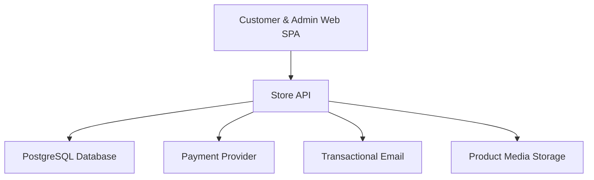
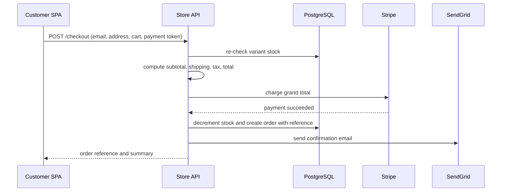
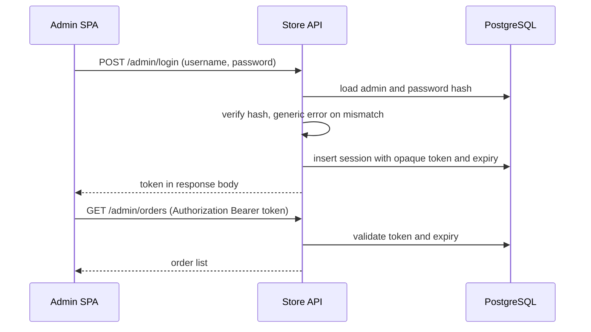
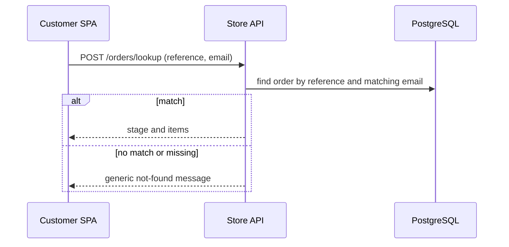
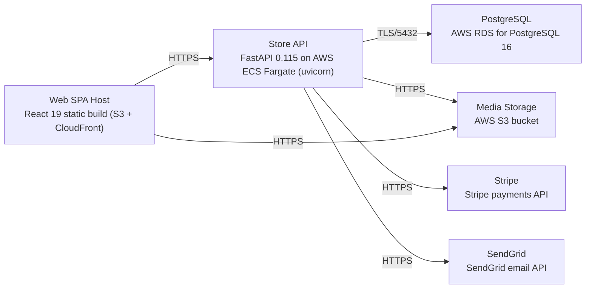

# Architecture

> Maintained by QuorQ AI SDLC. Text between `sdlc:auto` markers is regenerated; anything outside them is yours and is kept.

<!-- sdlc:auto:start narrative -->
## Overview

### ARCH-OVERVIEW · approved · source: architecture:summary

Mobile-responsive React 19 SPA on its own origin talking to a FastAPI 0.115 API, backed by PostgreSQL 16, all on AWS.

Customers browse by category, view products with size/colour variants and stock, cart, and guest-checkout with card payment via Stripe; each paid order gets a unique reference and a SendGrid confirmation email, and can be tracked by reference plus email. Admins sign in (server-side opaque-token sessions) to manage products, variants, images (S3), orders and fulfilment stages, and configure country/currency, flat-rate shipping with free-over-threshold, and one tax rate.

### ARCH-COMP-web_spa · approved · source: architecture:component:web_spa

Customer & Admin Web SPA built in React 19.

Mobile-responsive storefront (browse, product, cart, checkout, order tracking) and protected admin UI. Stores the opaque admin session token and sends it as Authorization: Bearer on admin calls. Reads API base URL from VITE_API_BASE_URL.

**Related:** ARCH-COMP-api

### ARCH-COMP-api · approved · source: architecture:component:api

Store API built with FastAPI 0.115.

Serves catalogue, cart pricing, checkout/payment orchestration, order reference generation, order lookup, admin auth/sessions, catalogue and order management, and store configuration; enforces single-country shipping and stock rules.

**Related:** ARCH-COMP-db, ARCH-COMP-payment, ARCH-COMP-email, ARCH-COMP-media_store

### ARCH-COMP-db · approved · source: architecture:component:db

PostgreSQL 16 database.

Persists products, variants, stock, categories, orders, order items, admin users, sessions and store configuration.

### ARCH-COMP-media_store · approved · source: architecture:component:media_store

Product media storage using AWS S3.

Stores and serves uploaded product images; this is the app's own media storage on AWS.

### ARCH-COMP-payment · approved · source: architecture:component:payment

Stripe is the payment provider.

Takes card payment for the grand total at checkout; the store never stores card details.

### ARCH-COMP-email · approved · source: architecture:component:email

SendGrid is the transactional email provider.

Sends order confirmation emails containing the order reference, items and total.

### ARCH-PATH-checkout · approved · source: architecture:critical_path:guest_checkout_and_payment

Guest checkout and payment flow, including stock re-validation, totals, payment, and order creation.

Customer submits email, in-country shipping address and cart. API re-validates stock and recomputes totals (subtotal + flat-rate or free shipping + tax), takes card payment via Stripe, and on success atomically decrements stock, generates a unique order reference, and queues the confirmation email. Payment failure or sold-out stock blocks order creation and preserves the cart.

**Related:** ARCH-COMP-api, ARCH-COMP-payment, ARCH-COMP-db, ARCH-COMP-email

### ARCH-PATH-admin-auth · approved · source: architecture:critical_path:admin_signin_and_session

Admin sign-in and session lifecycle using server-side opaque tokens.

Admin submits username/password; API verifies the bcrypt hash, creates a server-side session row with an opaque token and expiry, and returns the token in the body. The SPA stores it and sends it as Bearer on admin calls; a dependency validates the token and sliding expiry; sign-out revokes the session.

**Related:** ARCH-COMP-api, ARCH-COMP-db, ARCH-COMP-web_spa

### ARCH-PATH-tracking · approved · source: architecture:critical_path:order_tracking

Order tracking by reference and email, with a non-revealing failure message.

Customer enters order reference and email; API returns order items and current fulfilment stage only when both match, and a single non-revealing message otherwise.

**Related:** ARCH-COMP-api, ARCH-COMP-db

### ARCH-ENTITIES · approved · source: architecture:entities

Data model entities persisted in PostgreSQL.

category(id, name, slug); product(id, category_id, name, description, price, is_active, created_at); product_variant(id, product_id, size, colour, stock_quantity, sku); product_image(id, product_id, s3_key, position); order(id, reference, email, shipping_name, shipping_address_line1, shipping_address_line2, shipping_city, shipping_postcode, shipping_country, subtotal, shipping_amount, tax_amount, grand_total, currency, fulfilment_stage, payment_reference, created_at); order_item(id, order_id, variant_id, product_name, size, colour, unit_price, quantity, line_total); admin_user(id, username, password_hash, is_active, created_at); admin_session(token, admin_user_id, created_at, expires_at, revoked_at); store_config(id, country, currency, tax_rate, flat_shipping_amount, free_shipping_threshold, pending_confirmation).

**Related:** ARCH-COMP-db

### ARCH-ENDPOINTS · approved · source: architecture:endpoints

API endpoint inventory covering storefront, checkout, tracking and admin management.

GET /categories; GET /categories/{slug}/products; GET /products/{id}; POST /cart/validate; POST /checkout/quote; POST /checkout; POST /orders/lookup; POST /admin/login; POST /admin/logout; GET /admin/products; POST /admin/products; PUT /admin/products/{id}; POST /admin/products/{id}/variants; POST /admin/products/{id}/images; DELETE /admin/products/{id}/images/{image_id}; GET /admin/orders; GET /admin/orders/{id}; PATCH /admin/orders/{id}/stage; GET /admin/config; PUT /admin/config.

**Related:** ARCH-COMP-api

### ARCH-DEPLOYMENT-NODES · approved · source: architecture:deployment_nodes

AWS-hosted deployment topology for all components plus two SaaS integrations.

Web SPA Host: React 19 static build on S3 + CloudFront. Store API: FastAPI 0.115 on AWS ECS Fargate (uvicorn), Python 3.12. PostgreSQL: AWS RDS for PostgreSQL 16. Media Storage: AWS S3 bucket. Stripe: Stripe payments API (SaaS). SendGrid: SendGrid email API (SaaS).

**Related:** ARCH-COMP-web_spa, ARCH-COMP-api, ARCH-COMP-db, ARCH-COMP-media_store, ARCH-COMP-payment, ARCH-COMP-email

### ARCH-DECISION-frontend · approved · source: architecture:technology_decision:frontend

React 19 chosen as the frontend framework over Vue or SvelteKit.

Approved stack; built as a mobile-responsive SPA (Vite) served from its own origin, storing the admin opaque token and sending it as Authorization: Bearer.

**Related:** ARCH-COMP-web_spa

### ARCH-DECISION-backend · approved · source: architecture:technology_decision:backend

FastAPI 0.115 chosen as the backend framework over Django REST Framework or Flask.

Approved stack; hosts catalogue, checkout orchestration, Stripe/SendGrid/S3 integration, admin auth and session validation with Pydantic validation for checkout and product forms.

**Related:** ARCH-COMP-api

### ARCH-DECISION-database · approved · source: architecture:technology_decision:database

PostgreSQL 16 chosen as the database over MySQL or SQLite.

Approved stack; relational model fits products, variants, orders and transactional stock decrement with a unique order reference index. Full catalogue, orders and config all live here.

**Related:** ARCH-COMP-db

### ARCH-DECISION-cloud · approved · source: architecture:technology_decision:cloud

AWS chosen as the cloud provider over GCP or Azure.

Approved stack; RDS for PostgreSQL 16, S3 for the app's own product media storage, ECS Fargate for the API and S3/CloudFront for the SPA.

**Related:** ARCH-COMP-db, ARCH-COMP-media_store, ARCH-COMP-api, ARCH-COMP-web_spa
<!-- sdlc:auto:end narrative -->

<!-- sdlc:auto:start building-blocks -->
## Building Block View

| ID | Name | Technology | Responsibility | Depends on |
|---|---|---|---|---|
| web_spa | Customer & Admin Web SPA | React 19 | Mobile-responsive storefront (browse, product, cart, checkout, order tracking) and protected admin UI; stores the opaque session token and sends it as Authorization: Bearer on admin calls; reads API base URL from VITE_API_BASE_URL. | api |
| api | Store API | FastAPI 0.115 | Serves catalogue, cart pricing, checkout/payment orchestration, order reference generation, order lookup, admin auth/sessions, catalogue and order management, and store configuration; enforces single-country shipping and stock rules. | db, payment, email, media_store |
| db | PostgreSQL Database | PostgreSQL 16 | Persists products, variants, stock, categories, orders, order items, admin users, sessions and store configuration. | — |
| media_store | Product Media Storage | AWS S3 | Stores and serves uploaded product images (the app's own media storage on AWS). | — |
| payment | Payment Provider | Stripe | Takes card payment for the grand total at checkout; the store never stores card details. | — |
| email | Transactional Email | SendGrid | Sends order confirmation emails containing the reference, items and total. | — |

<!-- sdlc:auto:end building-blocks -->

<!-- sdlc:auto:start runtime -->
## Runtime View

### Guest checkout and payment

Customer submits email, in-country shipping address and cart; API re-validates stock and recomputes totals (subtotal + flat-rate or free shipping + tax), takes card payment via Stripe, and on success atomically decrements stock, generates a unique order reference, and queues the confirmation email. Payment failure or sold-out stock blocks order creation and preserves the cart.

- **Components:** web_spa, api, db, payment, email
- **Modules:** checkout_router, pricing_service, stock_service, order_service, payment_service, email_service
- **Key functions:** quote_totals(cart, config), validate_in_country(address, config), reserve_and_check_stock(cart), take_payment(amount, currency, token), create_order(email, address, items, totals), generate_order_reference(), send_confirmation(order)

### Admin sign-in and session

Admin submits username/password; API verifies the bcrypt hash, creates a server-side session row with an opaque token and expiry, and returns the token in the body. The SPA stores it and sends it as Bearer on admin calls; a dependency validates the token and sliding expiry, and sign-out revokes the session.

- **Components:** web_spa, api, db
- **Modules:** auth_router, session_service, password_hasher, auth_dependency
- **Key functions:** verify_credentials(username, password), create_session(admin_id), require_admin(token), revoke_session(token)

### Order tracking by reference and email

Customer enters order reference and email; API returns order items and current fulfilment stage only when both match, and a single non-revealing message otherwise.

- **Components:** web_spa, api, db
- **Modules:** tracking_router, order_service
- **Key functions:** lookup_order(reference, email)

<!-- sdlc:auto:end runtime -->

<!-- sdlc:auto:start deployment-view -->
## Deployment View

| Name | Service | Runtime | Scaling | Environment |
|---|---|---|---|---|
| Web SPA Host | React 19 static build (S3 + CloudFront) | Static site | CDN edge cache | dev |
| Store API | FastAPI 0.115 on AWS ECS Fargate (uvicorn) | Python 3.12 | 1 task in dev, horizontal later | dev |
| PostgreSQL | AWS RDS for PostgreSQL 16 | PostgreSQL 16 | Single instance, encryption at rest enabled | dev |
| Media Storage | AWS S3 bucket | S3 | Managed | dev |
| Stripe | Stripe payments API | SaaS | Managed | dev |
| SendGrid | SendGrid email API | SaaS | Managed | dev |

| Source | Target | Protocol |
|---|---|---|
| Web SPA Host | Store API | HTTPS |
| Store API | PostgreSQL | TLS/5432 |
| Store API | Media Storage | HTTPS |
| Store API | Stripe | HTTPS |
| Store API | SendGrid | HTTPS |
| Web SPA Host | Media Storage | HTTPS |

<!-- sdlc:auto:end deployment-view -->

<!-- sdlc:auto:start decisions -->
## Architecture Decisions

| Layer | Choice | ADR |
|---|---|---|
| Frontend | React 19 | [ADR-0001](adr/frontend.md) |
| Backend | FastAPI 0.115 | [ADR-0002](adr/backend.md) |
| Database | PostgreSQL 16 | [ADR-0003](adr/database.md) |
| Cloud | AWS | [ADR-0004](adr/cloud.md) |
<!-- sdlc:auto:end decisions -->

<!-- sdlc:auto:start links -->
## Related Documents

- [Data Model](data-model.md)
- [API Specification](api/openapi.yaml)
- [Architecture Decision Records](adr/README.md)
<!-- sdlc:auto:end links -->
