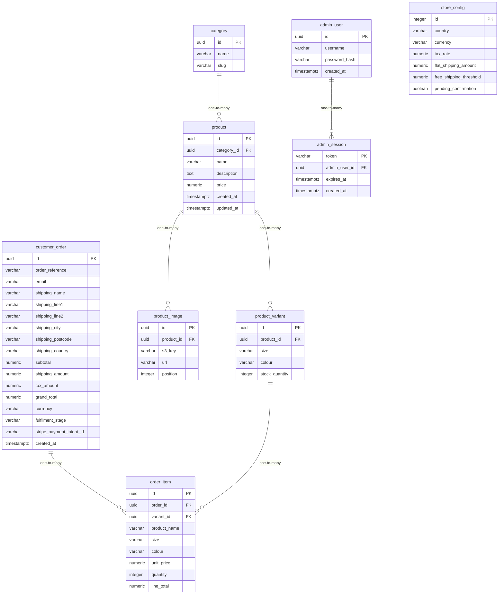

# Data Model

<!-- sdlc:auto:start entities -->
### category

| Field | Type | PK | FK | Nullable |
|---|---|---|---|---|
| id | uuid | True | — | False |
| name | varchar | False | — | False |
| slug | varchar | False | — | False |

### product

| Field | Type | PK | FK | Nullable |
|---|---|---|---|---|
| id | uuid | True | — | False |
| category_id | uuid | False | category.id | False |
| name | varchar | False | — | False |
| description | text | False | — | True |
| price | numeric | False | — | False |
| created_at | timestamptz | False | — | False |
| updated_at | timestamptz | False | — | False |

### product_variant

| Field | Type | PK | FK | Nullable |
|---|---|---|---|---|
| id | uuid | True | — | False |
| product_id | uuid | False | product.id | False |
| size | varchar | False | — | False |
| colour | varchar | False | — | False |
| stock_quantity | integer | False | — | False |

### product_image

| Field | Type | PK | FK | Nullable |
|---|---|---|---|---|
| id | uuid | True | — | False |
| product_id | uuid | False | product.id | False |
| s3_key | varchar | False | — | False |
| url | varchar | False | — | False |
| position | integer | False | — | False |

### customer_order

| Field | Type | PK | FK | Nullable |
|---|---|---|---|---|
| id | uuid | True | — | False |
| order_reference | varchar | False | — | False |
| email | varchar | False | — | False |
| shipping_name | varchar | False | — | False |
| shipping_line1 | varchar | False | — | False |
| shipping_line2 | varchar | False | — | True |
| shipping_city | varchar | False | — | False |
| shipping_postcode | varchar | False | — | False |
| shipping_country | varchar | False | — | False |
| subtotal | numeric | False | — | False |
| shipping_amount | numeric | False | — | False |
| tax_amount | numeric | False | — | False |
| grand_total | numeric | False | — | False |
| currency | varchar | False | — | False |
| fulfilment_stage | varchar | False | — | False |
| stripe_payment_intent_id | varchar | False | — | True |
| created_at | timestamptz | False | — | False |

### order_item

| Field | Type | PK | FK | Nullable |
|---|---|---|---|---|
| id | uuid | True | — | False |
| order_id | uuid | False | customer_order.id | False |
| variant_id | uuid | False | product_variant.id | True |
| product_name | varchar | False | — | False |
| size | varchar | False | — | False |
| colour | varchar | False | — | False |
| unit_price | numeric | False | — | False |
| quantity | integer | False | — | False |
| line_total | numeric | False | — | False |

### admin_user

| Field | Type | PK | FK | Nullable |
|---|---|---|---|---|
| id | uuid | True | — | False |
| username | varchar | False | — | False |
| password_hash | varchar | False | — | False |
| created_at | timestamptz | False | — | False |

### admin_session

| Field | Type | PK | FK | Nullable |
|---|---|---|---|---|
| token | varchar | True | — | False |
| admin_user_id | uuid | False | admin_user.id | False |
| expires_at | timestamptz | False | — | False |
| created_at | timestamptz | False | — | False |

### store_config

| Field | Type | PK | FK | Nullable |
|---|---|---|---|---|
| id | integer | True | — | False |
| country | varchar | False | — | True |
| currency | varchar | False | — | True |
| tax_rate | numeric | False | — | True |
| flat_shipping_amount | numeric | False | — | False |
| free_shipping_threshold | numeric | False | — | False |
| pending_confirmation | boolean | False | — | False |
<!-- sdlc:auto:end entities -->

<!-- sdlc:auto:start relationships -->
| Source | Target | Type |
|---|---|---|
| category | product | one-to-many |
| product | product_variant | one-to-many |
| product | product_image | one-to-many |
| customer_order | order_item | one-to-many |
| product_variant | order_item | one-to-many |
| admin_user | admin_session | one-to-many |
<!-- sdlc:auto:end relationships -->

<!-- sdlc:auto:start er-diagram -->

<!-- sdlc:auto:end er-diagram -->
