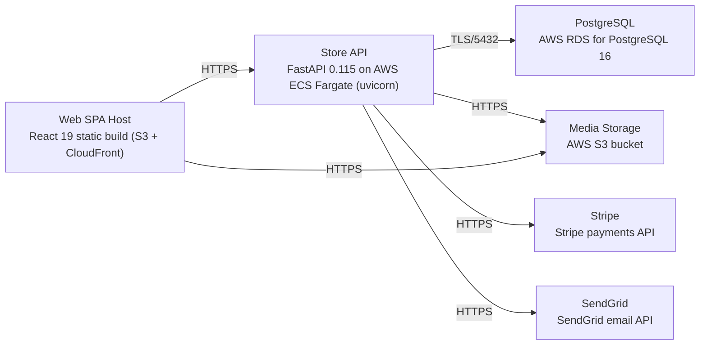

# Deployment Guide

> Maintained by QuorQ AI SDLC. Text between `sdlc:auto` markers is regenerated; anything outside them is yours and is kept.

<!-- sdlc:auto:start how-it-deploys -->
Pushes to `main` run `.github/workflows/deploy.yml`, which builds the API image (if there is a backend) and deploys the SPA to AWS Amplify. Commits touching only `docs/sdlc/**` don't deploy. Deployments can also be started from the platform's Deployment tab.
<!-- sdlc:auto:end how-it-deploys -->

<!-- sdlc:auto:start environments -->
| Name | Service | Runtime | Scaling | Environment |
|---|---|---|---|---|
| Web SPA Host | React 19 static build (S3 + CloudFront) | Static site | CDN edge cache | dev |
| Store API | FastAPI 0.115 on AWS ECS Fargate (uvicorn) | Python 3.12 | 1 task in dev, horizontal later | dev |
| PostgreSQL | AWS RDS for PostgreSQL 16 | PostgreSQL 16 | Single instance, encryption at rest enabled | dev |
| Media Storage | AWS S3 bucket | S3 | Managed | dev |
| Stripe | Stripe payments API | SaaS | Managed | dev |
| SendGrid | SendGrid email API | SaaS | Managed | dev |
<!-- sdlc:auto:end environments -->

<!-- sdlc:auto:start live -->
_Not deployed yet._
<!-- sdlc:auto:end live -->

<!-- sdlc:auto:start topology -->

<!-- sdlc:auto:end topology -->
